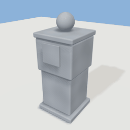

# trashcan

`asset: trashcan.yaml` · [source](../../../assets/trashcan.yaml) · `street.trashcan`

 

City street trash receptacle: a square bin with a swing-top lid. Anyone carrying a wrapper
(items/wrapper.yaml) can throw it away: the `bin` interaction's `when` lets them, its
rule takes the wrapper, and the `bin` affordance in front offers it to NPCs with a `tidy`
need (the fairgoers of examples/amusement_park). Origin is at bottom_center.

```yaml
place:
  trashcan: {asset: trashcan.yaml, params: {width: 0.45, height: 1}, state: binning}
```

## Params

| Param | Default | Choices | Notes |
| --- | --- | --- | --- |
| `width` | `0.45` |  |  |
| `height` | `1` |  |  |
| `depth` | `0.45` |  |  |

## Size

0.45 x 1 x 0.45 m (x, y, z); geometry (-0.225, 0, -0.225) to (0.225, 1.09, 0.242) from the origin; 1384 triangles

## Parts

`base` (cube), `body_lower` (cube), `body_upper` (cube), `rim` (cube), `lid` (sphere), `opening_frame` (cube)

## Interactions

bin: ready* -> binning, binning (then ready after 0.5 s) (* initial)

## Affordances

stand at (0, 0, 0.55) [outside, bin]
