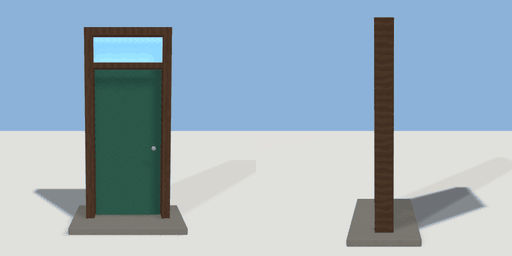

# travel_door

`asset: travel_door.yaml` · [source](../../../assets/travel_door.yaml) · `travel.door`

 

A freestanding door in a frame that leads somewhere else: press E on the
leaf to travel (geogen/travel.py). A glowing transom and a lettered board on
top say where it goes; a placement sets the destination:

```yaml
back_to_hub:
  asset: travel_door.yaml
  params: { label: Hub }
  travel: { scene: hub, spawn: arrival_cottage }
```

Origin: bottom centre; the door faces +Z (usable from both sides).

```yaml
place:
  travel_door: {asset: travel_door.yaml, params: {label: , width: 1}, state: going}
```

## Params

| Param | Default | Choices | Notes |
| --- | --- | --- | --- |
| `label` | `` | text | destination lettering ("" = none) |
| `width` | `1` |  | opening |
| `height` | `2.2` |  | opening under the transom |
| `transom` | `0.45` |  |  |
| `frame` | `0.12` |  |  |
| `depth` | `0.25` |  |  |
| `plinth` | `0.1` |  |  |
| `letter` | `0.16` |  |  |
| `board` | `1.5` |  | sign board width (fit it to the label) |

## Size

1.64 x 2.87 x 0.95 m (x, y, z); geometry (-0.82, 0, -0.475) to (0.82, 2.87, 0.475) from the origin; 1164 triangles

## Parts

`base` (cube), `frame` (extrude), `transom_bar` (cube), `transom_glass` (cube), `leaf` (extrude), `knob_front` (sphere), `knob_back` (sphere), `sign` (cube), `label_front` (text), `label_back` (text)

## Interactions

travel: ready* -> going, going (then ready) (* initial)

## Light

type omni, color [0.45,0.8,1], energy 0.6, range 4, offset [0,2.525,0.6]

## Travel

on use, prompt Go, target leaf
