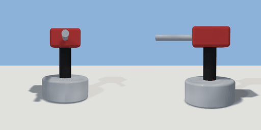

# turret

`asset: turret.yaml` · [source](../../../assets/turret.yaml) · `machine.turret`

 

A small gun turret: a steel drum base, a post and a turning head with a barrel. Its
effector (geogen.flows) shoots spawned items with hp in `range`, `rate` times a second for
`damage` each, turning its head toward the target; `enabled: 0` keeps it quiet until a rule
or wire enables it. Origin: on the ground under the post; the barrel points +Z at rest.

```yaml
place:
  turret: {asset: turret.yaml, params: {range: 5, rate: 1.5}}
```

## Params

| Param | Default | Choices | Notes |
| --- | --- | --- | --- |
| `range` | `5` |  |  |
| `rate` | `1.5` |  |  |
| `damage` | `2` |  |  |
| `targets` | `first` | text |  |
| `enabled` | `1` |  |  |

## Size

0.7 x 1.01 x 1.09 m (x, y, z); geometry (-0.35, 0, -0.35) to (0.35, 1.01, 0.74) from the origin; 1080 triangles

## Parts

`base` (cylinder), `post` (cylinder), `head` (cube), `barrel` (cylinder)

## Attachments

| Attachment | Position | Facing |
| --- | --- | --- |
| `muzzle` | (0, 0.88, 0) | center |
