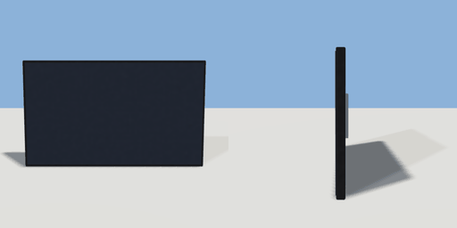

# tv

`asset: tv.yaml` · [source](../../../assets/tv.yaml) · `furniture.tv` `electronics.tv`

 

Wall-mounted flat TV. Origin: bottom-centre on the wall, screen faces +Z
(place on a wall surface: on: suite.bedroom.north_wall).

```yaml
place:
  tv: {asset: tv.yaml, params: {width: 1.1, height: 0.65}, state: on}
```

## Params

| Param | Default | Choices | Notes |
| --- | --- | --- | --- |
| `width` | `1.1` |  |  |
| `height` | `0.65` |  |  |
| `depth` | `0.06` |  |  |

## Size

1.1 x 0.65 x 0.06 m (x, y, z); geometry (-0.55, 0, 0) to (0.55, 0.65, 0.063) from the origin; 132 triangles

## Parts

`body` (cube), `bracket` (cube), `screen` (cube)

## Interactions

power: off* -> on, on -> off (* initial)
