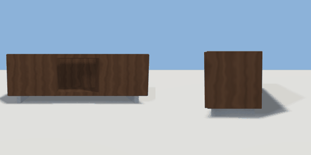

# tv_console

`asset: tv_console.yaml` · [source](../../../assets/tv_console.yaml) · `furniture.console`

 

Low media console with two push doors and an open shelf. Origin
bottom_center, front +Z.

```yaml
place:
  tv_console: {asset: tv_console.yaml, params: {width: 1.4, height: 0.5}}
```

## Params

| Param | Default | Choices | Notes |
| --- | --- | --- | --- |
| `width` | `1.4` |  |  |
| `height` | `0.5` |  |  |
| `depth` | `0.42` |  |  |

## Size

1.4 x 0.5 x 0.42 m (x, y, z); geometry (-0.7, 0, -0.21) to (0.7, 0.5, 0.208) from the origin; 748 triangles

## Parts

`body` (cube), `niche` (cube), `door_left` (cube), `door_right` (cube), `leg_l` (cube), `leg_r` (cube)

## Surfaces

| Surface | Size (u x v, m) | Facing |
| --- | --- | --- |
| `top` | 1.4 x 0.4 | +Y |

## Clearance

front 0.6
