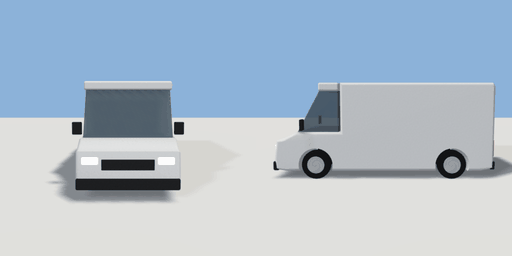

# van

`asset: vehicles/van.yaml` · [source](../../../assets/vehicles/van.yaml) · `vehicle.van`

 

A panel van: short bonnet, glazed cab, windowless cargo box. Built along +Z
(front), origin on the ground midway between the axles, left = +X, parts in
metres (unit container, `bounds: geometry`). Paint is a vertex tint.

```yaml
place:
  van: {asset: vehicles/van.yaml, params: {paint: orange, length: 5.3}}
```

## Params

| Param | Default | Choices | Notes |
| --- | --- | --- | --- |
| `length` | `5.3` |  |  |
| `width` | `2` |  |  |
| `height` | `2.35` |  |  |
| `wheelbase` | `3.3` |  |  |
| `wheel_r` | `0.35` |  |  |
| `tyre_w` | `0.23` |  |  |
| `belt` | `1.15` |  |  |
| `hood` | `1` |  |  |
| `cab_len` | `1` |  | from the windscreen base back to the B pillar |
| `paint` | `car_white` | car_white, silver, graphite, car_black, car_red, car_blue, car_navy, british_green, beige, orange |  |

## Size

2.32 x 2.33 x 5.36 m (x, y, z); geometry (-1.16, 0, -2.68) to (1.16, 2.33, 2.68) from the origin; 7240 triangles

## Parts

`body` (extrude), `arch_front` (cylinder), `arch_rear` (cylinder), `cab_glass` (extrude), `cab_roof` (cube), `bumper_front` (cube), `bumper_rear` (cube), `grille` (cube), `headlight_left` (cube), `headlight_right` (cube), `taillight_left` (cube), `taillight_right` (cube), `mirror_left` (cube), `mirror_right` (cube), `wheel_fl` (cylinder), `wheel_fr` (cylinder), `wheel_rl` (cylinder), `wheel_rr` (cylinder), `hub_fl` (cylinder), `hub_fr` (cylinder), `hub_rl` (cylinder), `hub_rr` (cylinder)

## Vehicle

class van, max_speed 14, turn_radius 6.5, accel 2, decel 4, wheelbase 3.3, track 1.72, clearance [5.36,2.32,2.33]
