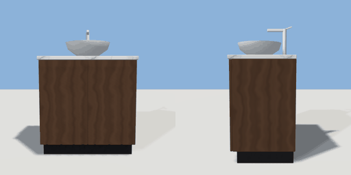

# vanity

`asset: vanity.yaml` · [source](../../../assets/vanity.yaml) · `bathroom.vanity` `bathroom.basin`

 

Bathroom vanity: two-door cabinet, marble top, vessel basin and a chrome
mixer tap. Back against the wall (-Z), origin bottom_center.

```yaml
place:
  vanity: {asset: vanity.yaml, params: {width: 0.8, depth: 0.5}}
```

## Params

| Param | Default | Choices | Notes |
| --- | --- | --- | --- |
| `width` | `0.8` |  |  |
| `depth` | `0.5` |  |  |
| `top` | `0.84` |  | counter height |

## Size

0.8 x 1.12 x 0.5 m (x, y, z); geometry (-0.41, 0, -0.269) to (0.41, 1.124, 0.26) from the origin; 1572 triangles

## Parts

`cabinet` (cube), `plinth` (cube), `door_left` (cube), `door_right` (cube), `counter` (cube), `basin` (lathe), `tap_body` (cylinder), `tap_spout` (cube), `tap_lever` (cube)

## Surfaces

| Surface | Size (u x v, m) | Facing |
| --- | --- | --- |
| `counter` | 0.82 x 0.51 | +Y |

## Clearance

front 0.7
