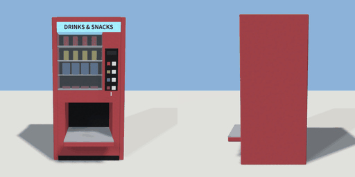

# vending_cabinet

`asset: vending_cabinet.yaml` · [source](../../../assets/vending_cabinet.yaml) · `machine.vending`

 

A vending machine's cabinet. For vending_machine.yaml: a red steel box with a glass window
on four shelves of stock, a lit header, a column of four selection buttons
(each with a swatch of its product's colour) and a tray at the bottom that runs out onto
a ledge in front, where products land (and a pile tumbles off). Pressing a
button emits `a`..`d`; vending_machine.yaml wires them to the sources that drop the
product into the tray (`tray_a`..`tray_d` are where each one appears).
Origin: on the ground under the cabinet's middle; the front faces +Z.

```yaml
place:
  vending_cabinet: {asset: vending_cabinet.yaml, params: {colour: car_red}, state: {a: down}}
```

## Params

| Param | Default | Choices | Notes |
| --- | --- | --- | --- |
| `colour` | `car_red` | text |  |

## Size

0.9 x 1.8 x 0.98 m (x, y, z); geometry (-0.45, 0, -0.4) to (0.45, 1.8, 0.58) from the origin; 5112 triangles

## Parts

`side_l` (cube), `side_r` (cube), `base` (cube), `kick` (cube), `top` (cube), `back` (cube), `lower_core` (cube), `upper_core` (cube), `cheek_l` (cube), `cheek_r` (cube), `hood` (cube), `tray_floor` (cube), `ledge` (cube), `sill` (cube), `header` (cube), `lettering` (text), `window` (cube), `column` (cube), `panel` (cube), `screen` (cube), `coin_slot` (cube), `button_a` (cube), `button_b` (cube), `button_c` (cube), `button_d` (cube), `swatch_a` (cube), `swatch_b` (cube), `swatch_c` (cube), `swatch_d` (cube), `shelf` (cube), `cola` (cylinder), `lemonade` (cylinder), `crisps` (cube), `chocolate` (cube)

## Attachments

| Attachment | Position | Facing |
| --- | --- | --- |
| `tray_a` | (-0.21, 0.6, 0.1) | north |
| `tray_b` | (-0.07, 0.6, 0.1) | north |
| `tray_c` | (0.06, 0.6, 0.1) | north |
| `tray_d` | (0.22, 0.6, 0.1) | north |

## Interactions

- a: up* -> down, down (then up after 0.25 s) (* initial; translates button_a)
- b: up* -> down, down (then up after 0.25 s) (* initial; translates button_b)
- c: up* -> down, down (then up after 0.25 s) (* initial; translates button_c)
- d: up* -> down, down (then up after 0.25 s) (* initial; translates button_d)

## Clearance

front 0.8
