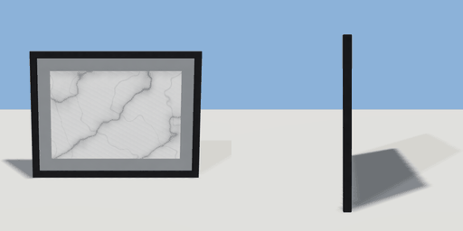

# wall_art

`asset: wall_art.yaml` · [source](../../../assets/wall_art.yaml) · `decor.wall_art`

 

Framed print for a wall. Origin bottom-centre on the wall, faces +Z.

```yaml
place:
  wall_art: {asset: wall_art.yaml, params: {width: 0.8, height: 0.6}}
```

## Params

| Param | Default | Choices | Notes |
| --- | --- | --- | --- |
| `width` | `0.8` |  |  |
| `height` | `0.6` |  |  |
| `frame` | `0.03` |  |  |
| `mat` | `0.06` |  | white mount inside the frame |

## Size

0.8 x 0.6 x 0.03 m (x, y, z); geometry (-0.4, 0, 0) to (0.4, 0.6, 0.03) from the origin; 152 triangles

## Parts

`frame` (extrude), `mount` (cube), `print` (cube)
