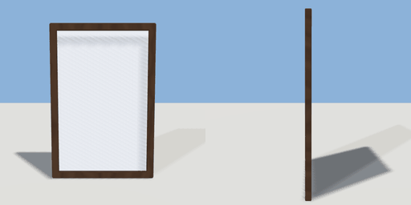

# wall_mirror

`asset: wall_mirror.yaml` · [source](../../../assets/wall_mirror.yaml) · `furniture.mirror`

 

Framed wall mirror. Origin bottom-centre on the wall, glass faces +Z.

```yaml
place:
  wall_mirror: {asset: wall_mirror.yaml, params: {width: 0.6, height: 0.9}}
```

## Params

| Param | Default | Choices | Notes |
| --- | --- | --- | --- |
| `width` | `0.6` |  |  |
| `height` | `0.9` |  |  |
| `frame` | `0.04` |  |  |

## Size

0.6 x 0.9 x 0.03 m (x, y, z); geometry (-0.3, 0, 0) to (0.3, 0.9, 0.03) from the origin; 652 triangles

## Parts

`frame` (extrude), `glass` (cube)
