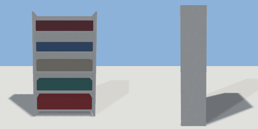

# wall_shelving

`asset: wall_shelving.yaml` · [source](../../../assets/wall_shelving.yaml) · `shop.shelving` `furniture.shelving`

 

Shop wall shelving: a tall steel unit with five shelves of stock (rows of
boxes and tins in mixed colours). Against a wall, back at -Z.

```yaml
place:
  wall_shelving: {asset: wall_shelving.yaml, params: {width: 1.2}}
```

## Params

| Param | Default | Choices | Notes |
| --- | --- | --- | --- |
| `width` | `1.2` |  |  |

## Size

1.2 x 2 x 0.425 m (x, y, z); geometry (-0.6, 0, -0.215) to (0.6, 2, 0.21) from the origin; 2364 triangles

## Parts

`back` (cube), `side_l` (cube), `side_r` (cube), `shelf_0` (cube), `stock_0` (cube), `shelf_1` (cube), `stock_1` (cube), `shelf_2` (cube), `stock_2` (cube), `shelf_3` (cube), `stock_3` (cube), `shelf_4` (cube), `stock_4` (cube)

## Clearance

front 0.9
