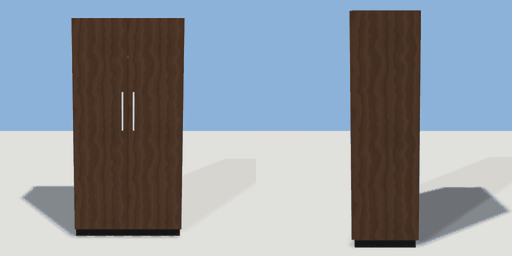

# wardrobe

`asset: wardrobe.yaml` · [source](../../../assets/wardrobe.yaml) · `furniture.wardrobe`

 

Two-door wardrobe on a plinth with bar handles; the doors swing out
(interaction 'doors'). Origin bottom_center, front +Z.

```yaml
place:
  wardrobe: {asset: wardrobe.yaml, params: {width: 1, height: 2}, state: open}
```

## Params

| Param | Default | Choices | Notes |
| --- | --- | --- | --- |
| `width` | `1` |  |  |
| `height` | `2` |  |  |
| `depth` | `0.58` |  |  |
| `board` | `0.022` |  |  |
| `plinth` | `0.07` |  |  |
| `door_t` | `0.02` |  |  |

## Size

1 x 2 x 0.58 m (x, y, z); geometry (-0.5, 0, -0.29) to (0.5, 2, 0.31) from the origin; 904 triangles

## Parts

`carcass` (cube), `hollow` (cube), `rail` (cylinder), `plinth` (cube), `door_left` (cube), `door_right` (cube), `handle_left` (cube), `handle_right` (cube)

## Interactions

doors: closed* -> open, open -> closed (* initial; rotates door_left, handle_left; rotates door_right, handle_right)

## Container

capacity 20, part carcass

## Clearance

front 0.8
