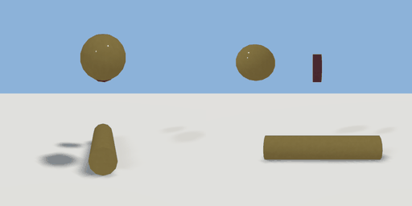

# wheat_sheaf

`asset: wheat_sheaf.yaml` · [source](../../../assets/wheat_sheaf.yaml) · `prop.crop`

 

A sheaf of wheat: a bundle of straw-gold stalks tied round the middle, ears at one end.
The body of items/wheat.yaml (a carryable physics prop). Origin: bottom centre; lying
along Z, ears at +Z.

```yaml
place:
  wheat_sheaf: {asset: wheat_sheaf.yaml}
```

## Size

0.128 x 0.42 x 0.518 m (x, y, z); geometry (-0.064, 0.21, -0.21) to (0.064, 0.63, 0.308) from the origin; 388 triangles

## Parts

`stalks` (cylinder), `ears` (ellipsoid), `tie` (cylinder)
