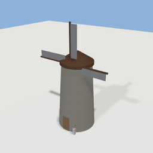
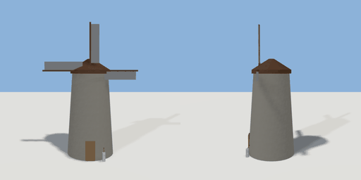

# windmill

`asset: windmill.yaml` · [source](../../../assets/windmill.yaml) · `building.windmill` `mechanism.windmill`

 

A windmill whose sails turn. A stone tower with a cap, and four sails on a hub that is
a mechanism body on a motorised hinge, turning from the moment the scene loads (`turn`
is `running` at first); the brake lever by the door stops and starts them. The sails
face +Z. Origin: the tower's foot.

```yaml
place:
  windmill: {asset: windmill.yaml, params: {height: 9, sail: 5}, state: stopped}
```

## Params

| Param | Default | Choices | Notes |
| --- | --- | --- | --- |
| `height` | `9` |  | the tower, to the cap |
| `sail` | `5` |  | each sail's length from the hub |
| `speed` | `20` |  | degrees a second (a turn every 18 s) |

## Size

10 x 14.3 x 5.35 m (x, y, z); geometry (-5, 0, -2.6) to (5, 14.3, 2.75) from the origin; 1248 triangles

## Parts

`tower` (lathe), `cap` (lathe), `axle` (cylinder), `door` (cube), `hub` (cylinder), `arm` (cube), `cloth` (cube), `pedestal` (cube), `handle` (cylinder), `knob` (sphere)

## Interactions

turn: running* -> stopped, stopped -> running (* initial; drive ; rotates handle)
