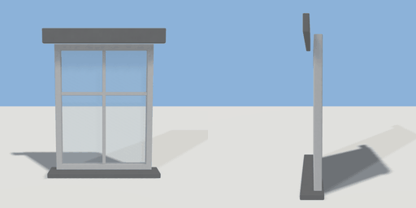

# window

`asset: window.yaml` · [source](../../../assets/window.yaml) · `window`

 

Casement window with frame, glazing bars, sill and lintel.

Place it on a wall surface; it cuts its own opening into the wall:

```yaml
window: { asset: window.yaml, on: house.front_wall, at: {u: 0.25, v: {abs: 0.9}} }
```

Origin is the bottom-centre of the opening on the wall face; +Z points out
of the wall. The container depth is 1 m so z offsets read as metres.

```yaml
place:
  window: {asset: window.yaml, on: <object>.<wall surface>, at: {u: 0.5, v: {abs: 0}}, params: {width: 1, height: 1.3}}
```

## Params

| Param | Default | Choices | Notes |
| --- | --- | --- | --- |
| `width` | `1` |  |  |
| `height` | `1.3` |  |  |
| `frame` | `0.06` |  | frame member width |
| `recess` | `0.09` |  | how far the frame sits back from the wall face |

## Size

1 x 1.3 x 1 m (x, y, z); geometry (-0.6, -0.047, -0.14) to (0.6, 1.437, 0.06) from the origin; 572 triangles

## Opening

cuts its own hole in the surface it is placed `on` (origin: bottom centre of the opening on the wall face, +Z out of the wall)

## Parts

`opening` (cube), `reveal` (cube), `frame` (extrude), `glass` (cube), `mullion` (cube), `transom` (cube), `sill` (cube), `lintel` (cube)

## Affordances

look at (0, 0, -0.8) [window]
