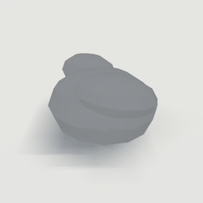
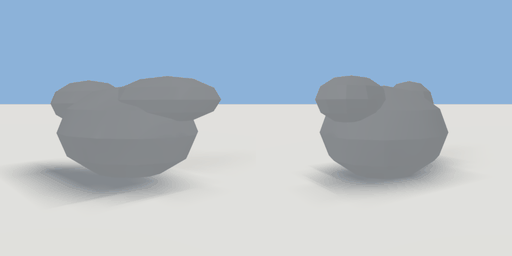

# wrapper

`asset: wrapper.yaml` · [source](../../../assets/wrapper.yaml) · `prop.litter`

 

A screwed-up paper wrapper: a crumpled ball with a couple of creases standing proud. The body
of items/wrapper.yaml. Origin: bottom centre.

```yaml
place:
  wrapper: {asset: wrapper.yaml}
```

## Size

0.12 x 0.07 x 0.089 m (x, y, z); geometry (-0.06, 0, -0.045) to (0.06, 0.07, 0.045) from the origin; 370 triangles

## Parts

`ball` (ellipsoid), `crease` (ellipsoid), `crease_2` (ellipsoid)
