# Primitives

An asset's `parts:` are primitives. Each takes the common part keys below plus its own.

```yaml
name: stool
size: [0.4, 0.45, 0.4]        # metres; part sizes are fractions of this
parts:
  seat: {primitive: cylinder, size: [1, 0.1, 1], anchor: top_center, offset: [0, -0.05, 0], material: wood}
  leg:  {primitive: cylinder, size: [0.15, 0.9, 0.15], attach_to: seat, at: bottom, from: top, material: metal}
```

## Part keys

| Key | Type | Default | Meaning |
| --- | --- | --- | --- |
| `primitive` | name |  | which generator builds the part |
| `size` | [x, y, z] |  | extent as fractions of the asset's `size` (metres when the asset size is [1, 1, 1]) |
| `anchor` | anchor | `center` | where in the asset box the part sits: center, bottom_center, top_front_left, ... (bottom anchors rest the part's base there) |
| `offset` | [x, y, z] | `[0,0,0]` | shift from the anchor in fractions of the asset size; metres after `attach_to` |
| `attach_to` | part |  | parent part to connect to (instead of anchor) |
| `at` | point | `top` | the parent's attachment point: top, bottom, left, right, front, back |
| `from` | point | `bottom` | the point on this part that meets the parent's |
| `rotation` | [x, y, z] deg |  | XYZ Euler rotation |
| `material` | material |  | a material from assets/materials/ (see Materials) |
| `tint` | colour |  | vertex colour over the material: a palette name or [r, g, b] |
| `when` | expr |  | drop the part, and parts attached to it, when it resolves to 0 / false |
| `array` | {count, step: [x, y, z]} |  | repeat the part as <part>_0..n-1, each `step` further along |
| `subtract` | [part, ...] |  | cut these parts out of this one (CSG difference) |
| `cutter` | bool | `false` | helper part: only used by another part's `subtract`, then removed |
| `cut_host` | bool | `false` | opening cutter applied to the surface the asset is placed on (doors, windows) |
| `reveal` | bool \| {bottom: bool} | `false` | the box behind an opening's frame that the host wall lines |
| `subdivide` | int \| {levels, crease} |  | Loop subdivision, stretched back to the part box |
| `displace` | {amplitude, scale, octaves, seed, ridged} |  | fractal noise along the normals |
| `tags` | [tag, ...] |  | dotted gameplay tags exported in extras.geogen |
| `collider` | auto \| none \| box \| hull \| mesh | `auto` | collision shape exported for the part |
| `walkable` | bool | `false` | the part is floor the player and NPCs walk on |
| `joint` | {type: hinge \| slide, pivot, limits \| range, with} |  | shorthand for a closed/open interaction named after the part |

Anchors: center, or any of top|bottom + front|back + left|right|center, e.g. bottom_center, top_front_left, left_center (x: left = -X, y: up, z: front = +Z).

## cube

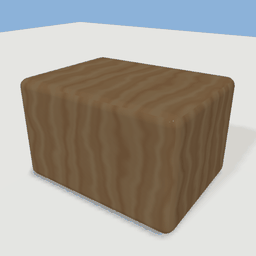

Rounded box filling the part size. Surfaces: front, back, left, right, top, bottom.

| Key | Type | Default | Meaning |
| --- | --- | --- | --- |
| `bevel` | m | `0.02` | edge radius; 0 for sharp boxes (do this for thin slabs) |
| `bevel_segments` | int | `2` | arc steps per 45 degrees (1 for parts under 12 cm) |

```yaml
{primitive: cube, size: [0.8, 0.5, 0.6], bevel: 0.04, material: wood}
```

## cylinder

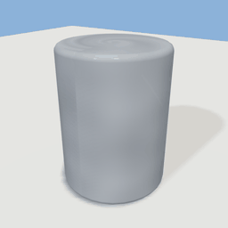

Upright cylinder; radius is half the smaller of x and z.

| Key | Type | Default | Meaning |
| --- | --- | --- | --- |
| `bevel` | m | `0` | rounded rim radius (sharp without it) |
| `bevel_segments` | int | `4` | arc steps of the rim |

```yaml
{primitive: cylinder, size: [0.6, 0.8, 0.6], bevel: 0.03, material: metal}
```

## sphere

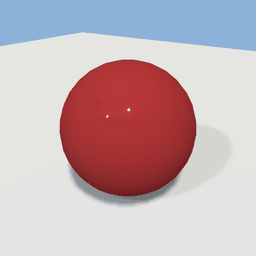

Sphere of diameter min(size).

```yaml
{primitive: sphere, size: [0.8, 0.8, 0.8], material: red_metal}
```

## ellipsoid

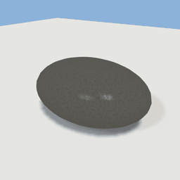

Sphere stretched to all three size components.

```yaml
{primitive: ellipsoid, size: [1, 0.5, 0.7], material: fabric_linen}
```

## cone

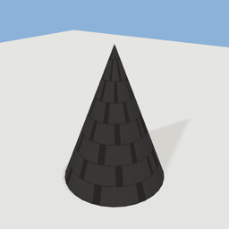

Upright cone; base radius is half the smaller of x and z.

```yaml
{primitive: cone, size: [0.7, 0.9, 0.7], material: roof_shingle}
```

## capsule

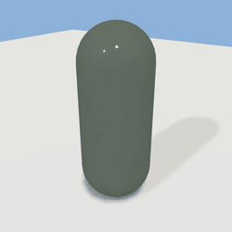

Upright cylinder with hemispherical ends; radius min(x, z) / 2.

```yaml
{primitive: capsule, size: [0.4, 1, 0.4], material: paint_sage}
```

## torus

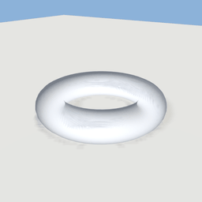

Ring lying in XZ, filling x and z.

| Key | Type | Default | Meaning |
| --- | --- | --- | --- |
| `tube` | m | `0` | tube radius (default: size y / 2) |

```yaml
{primitive: torus, size: [0.9, 0.2, 0.9], material: chrome}
```

## plane

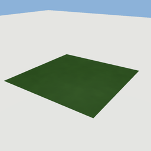

Flat sheet in XZ (y ignored). Surface: top.

| Key | Type | Default | Meaning |
| --- | --- | --- | --- |
| `subdivisions_x` | int | `1` | cells along x |
| `subdivisions_z` | int | `1` | cells along z |

```yaml
{primitive: plane, size: [1, 0, 1], material: grass}
```

## extrude

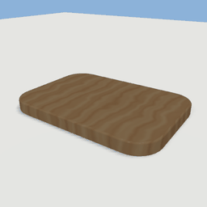

Extrude a 2D shape (with holes) along an axis; watertight, optional rounded cap edges.

| Key | Type | Default | Meaning |
| --- | --- | --- | --- |
| `shape` | shape |  | {rect: [w, h], radius} \| {circle: r} \| {polygon: [[x, y], ...]} \| {outer: ..., holes: [...]} \| [[x, y], ...] |
| `axis` | x \| y \| z | `y` | extrusion axis: y for slabs (profile in XZ), z for panels (XY) |
| `fit` | stretch \| none | `stretch` | scale the profile to the part size, or take it in metres |
| `bevel` | m | `0` | rounded cap edge radius |
| `bevel_segments` | int | `3` | arc steps of the cap bevel |
| `crease_angle` | deg | `40` | edges sharper than this stay hard |
| `caps` | bool | `true` | close both ends |

```yaml
{primitive: extrude, size: [1, 0.08, 0.7], shape: {rect: [1, 0.7], radius: 0.15}, bevel: 0.01, material: wood}
```

## lathe

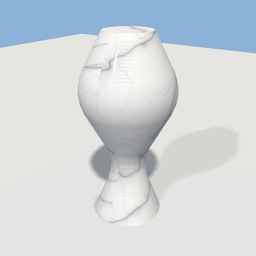

Revolve an (r, y) profile around Y: turned legs, vases, bowls.

| Key | Type | Default | Meaning |
| --- | --- | --- | --- |
| `profile` | polyline |  | [[r, y], ...] \| {spline: [[r, y], ...]} \| {segments: [...]}; r = 0 closes at the axis, repeating the first point makes a ring |
| `fit` | stretch \| none | `stretch` | scale the profile to the part size, or take it in metres |
| `segments` | int | `48` | radial steps (capped at one per 2.5 cm of circumference) |
| `sweep` | deg | `360` | partial revolution |
| `cap_bottom` | bool | `true` | flat disc on an open bottom end |
| `cap_top` | bool | `true` | flat disc on an open top end |
| `crease_angle` | deg | `40` | edges sharper than this stay hard |

```yaml
{primitive: lathe, size: [0.5, 1, 0.5], profile: {spline: [[0.6, 0], [0.3, 0.3], [0.8, 0.7], [0.4, 1]]}, material: marble}
```

## sweep

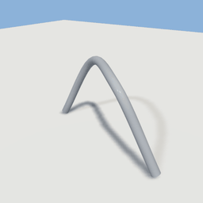

Sweep a profile shape along a 3D path (rails, pipes, mouldings), with mitred corners. `size` is optional (taken from the geometry).

| Key | Type | Default | Meaning |
| --- | --- | --- | --- |
| `profile` | shape |  | cross-section in metres (x = right of travel, y = up) |
| `path` | [[x, y, z], ...] \| {spline: [...], samples} |  | the centre line |
| `closed` | bool | `false` | join the end back to the start |
| `up` | [x, y, z] | `[0,1,0]` | the profile's up direction |
| `twist` | deg | `0` | twist over the whole path |
| `scale` | s \| [start, end] | `[1,1]` | profile scale along the path |
| `crease_angle` | deg | `40` | edges sharper than this stay hard |
| `center` | bool | `true` | false keeps the path in the asset frame (anchor ignored) |

```yaml
{primitive: sweep, profile: {circle: 0.03}, path: {spline: [[-0.5, 0, 0], [-0.2, 0.5, 0], [0.2, 0.5, 0.3], [0.5, 0, 0.3]]}, material: metal}
```

## text

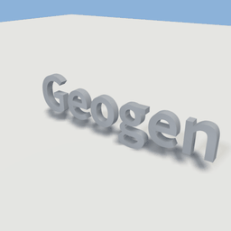

Extruded lettering reading along +X and facing +Z, centred on its bounds. `size` is optional (taken from the geometry).

| Key | Type | Default | Meaning |
| --- | --- | --- | --- |
| `text` | string | `Text` | the text; newlines split lines |
| `font` | sans \| serif | `sans` | bundled font |
| `height` | m | `0.2` | cap height |
| `depth` | m | `0.02` | extrusion depth |
| `align` | left \| center \| right | `center` | line alignment |
| `line_spacing` | factor | `1` | line pitch |
| `tracking` | em | `0` | extra letter spacing |
| `bevel` | m | `0` | rounded face edges |

```yaml
{primitive: text, text: Geogen, height: 0.25, depth: 0.05, material: metal}
```

## roof

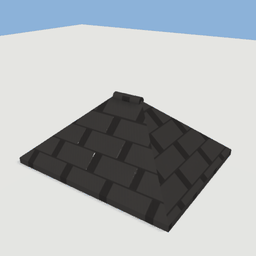

Pitched or flat roof over a wall-top footprint: size = footprint + rise, eaves overhang beyond it.

| Key | Type | Default | Meaning |
| --- | --- | --- | --- |
| `style` | gable \| hip \| shed \| flat | `gable` | roof form |
| `overhang` | m | `0.35` | eaves beyond the footprint |
| `thickness` | m | `0.12` | roof slab thickness |
| `ridge_axis` | auto \| x \| z | `auto` | ridge direction (auto: the longer side) |
| `ridge_cap` | bool | `true` | cap strip along the ridge |

```yaml
{primitive: roof, size: [1, 0.35, 0.8], style: hip, overhang: 0.06, thickness: 0.03, material: roof_shingle}
```

## prism

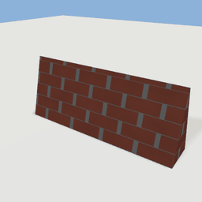

Triangular prism: gable-end infill, wedges and ramps.

| Key | Type | Default | Meaning |
| --- | --- | --- | --- |
| `apex` | center \| back \| front | `center` | where the ridge sits |

```yaml
{primitive: prism, size: [1, 0.4, 0.2], material: brick}
```

## stairs

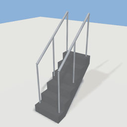

A climbable flight (one watertight solid) with swept handrails; climbs toward -Z. `size` is optional (taken from the geometry).

| Key | Type | Default | Meaning |
| --- | --- | --- | --- |
| `style` | straight \| l \| spiral | `straight` | flight shape |
| `rise` | m | `3` | total height climbed |
| `width` | m | `1` | flight width |
| `max_riser` | m | `0.18` | step count = ceil(rise / max_riser) |
| `tread` | m | `0.28` | going of each step |
| `turn` | left \| right | `left` | turn direction (l and spiral) |
| `landing_at` | 0-1 | `0.5` | where the landing sits (l) |
| `waist` | m | `0.15` | slab thickness under the steps |
| `railing` | both \| left \| right \| outer \| none | `both` | handrail sides |
| `rail_height` | m | `0.9` | handrail height |
| `railing_material` | material | `metal` | handrail material |

```yaml
{primitive: stairs, rise: 1, width: 0.6, tread: 0.2, material: concrete}
```

## room

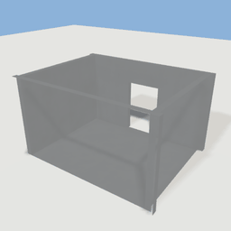

Hollow box room with openings. Surfaces (facing in): north_wall, south_wall, east_wall, west_wall, floor, ceiling. Prefer a `floorplan:` asset for real buildings.

| Key | Type | Default | Meaning |
| --- | --- | --- | --- |
| `wall_thickness` | m | `0.1` | wall thickness |
| `has_floor` | bool | `true` | build the floor |
| `has_ceiling` | bool | `true` | build the ceiling |
| `openings` | [{wall, position, bottom, width, height}] |  | door and window holes (fractions) |

```yaml
{primitive: room, size: [1, 0.6, 0.8], wall_thickness: 0.04, has_ceiling: false, openings: [{wall: south, position: 0.5, width: 0.25, height: 0.7}], material: wall_plaster}
```

## tree

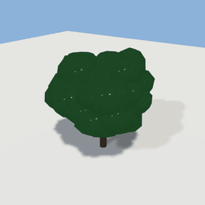

A tree grown in the part box: trunk (hull collider), branches and noise-displaced foliage.

| Key | Type | Default | Meaning |
| --- | --- | --- | --- |
| `style` | deciduous \| conifer \| palm | `deciduous` | crown shape |
| `seed` | int | `0` | random seed |
| `trunk_height` | 0-1 | `0.35` | bare trunk as a fraction of the height |
| `trunk_radius` | m | `0.16` | trunk radius at the ground |
| `attractors` | int | `260` | crown density (space colonisation points) |
| `step` | m | `0.35` | branch segment length |
| `leaf_size` | m | `0.55` | leaf cluster size |
| `segments` | int | `7` | radial steps of the branches |
| `foliage_material` | material |  | leaf material |
| `fronds` | int | `11` | frond count (palm) |

```yaml
{primitive: tree, size: [1, 1, 1], anchor: bottom_center, seed: 3, trunk_radius: 0.04, step: 0.09, leaf_size: 0.14, material: bark, foliage_material: foliage_green}
```

## rock

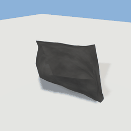

A random convex cage, subdivided, displaced and flat-bottomed.

| Key | Type | Default | Meaning |
| --- | --- | --- | --- |
| `seed` | int | `0` | random seed |
| `points` | int | `14` | cage points |
| `levels` | int | `3` | subdivision levels |
| `roughness` | 0-1 | `0.12` | displacement strength |
| `crease` | deg \| null | `50` | hard-edge angle (null: fully smooth) |

```yaml
{primitive: rock, size: [1, 0.6, 0.8], seed: 4, material: rock}
```

## paths

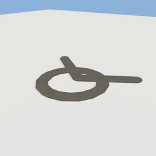

Path network: centre lines buffered, unioned and extruded (loops leave holes). Asset frame. `size` is optional (taken from the geometry).

| Key | Type | Default | Meaning |
| --- | --- | --- | --- |
| `paths` | [[[x, z], ...] \| {spline, closed} \| {circle: r, segments, center}] |  | the centre lines |
| `width` | m | `1.8` | path width |
| `thickness` | m | `0.04` | slab thickness |
| `bevel` | m | `0.01` | rounded top edge |

```yaml
{primitive: paths, paths: [[[-0.5, -0.4], [0, 0], [0.5, -0.3]], {circle: 0.3, center: [0, 0.1]}], width: 0.12, thickness: 0.03, material: gravel}
```

## fence

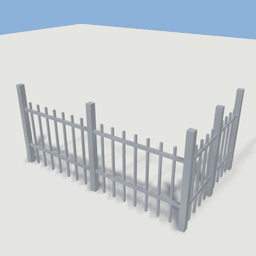

Posts, rails and pickets along a path, with gaps for gates. Asset frame. `size` is optional (taken from the geometry).

| Key | Type | Default | Meaning |
| --- | --- | --- | --- |
| `path` | [[x, z], ...] \| {circle: r, segments, center} |  | the fence line |
| `closed` | bool | `false` | join the end back to the start |
| `height` | m | `1.1` | fence height |
| `gaps` | [[from, to], ...] |  | openings in metres along the path |
| `post` | m | `0.08` | post thickness |
| `post_spacing` | m | `2.5` | distance between posts |
| `picket` | m | `0.02` | picket thickness |
| `spacing` | m | `0.12` | distance between pickets |
| `rail` | m | `0.035` | rail thickness |

```yaml
{primitive: fence, path: [[-0.5, 0.3], [0.5, 0.3], [0.5, -0.3]], height: 0.4, post: 0.03, post_spacing: 0.5, picket: 0.01, spacing: 0.06, rail: 0.015, material: metal}
```

## terrain

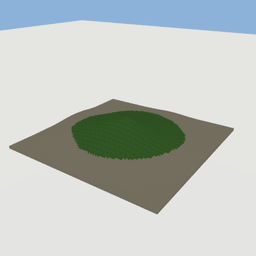

A closed heightfield solid (walkable): island or rolling ground with material bands. Asset frame. `size` is optional (taken from the geometry).

| Key | Type | Default | Meaning |
| --- | --- | --- | --- |
| `extent` | [x, z] |  | ground size in metres |
| `resolution` | m | `1` | grid cell size |
| `height` | m | `12` | peak above sea level |
| `sea_level` | m | `0` | y of the sea surface |
| `depth` | m | `4` | solid depth below the sea bed |
| `seed` | int | `0` | random seed |
| `scale` | m | `40` | noise feature size |
| `octaves` | int | `4` | noise octaves |
| `falloff` | {radius, edge, power} |  | island coastline (fractions of the smaller side) |
| `island` | bool | `true` | false for rolling ground without a coast |
| `pads` | [{center, radius, blend, height}] |  | levelled ground for buildings |
| `materials` | {sand, grass, rock, path} |  | materials by height and slope |
| `paths` | [{points, width}] |  | gravel ribbons draped on the ground |
| `shore` | {depth, height, openings} |  | collider-only barrier where the water gets deep |

```yaml
{primitive: terrain, extent: [60, 60], resolution: 1, height: 7, depth: 1, scale: 22, seed: 2, falloff: {radius: 0.4, edge: 0.15}}
```

## water

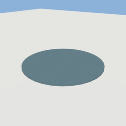

A thin water sheet from a shape (no collider); the Godot runtime gives it waves and foam.

| Key | Type | Default | Meaning |
| --- | --- | --- | --- |
| `shape` | shape |  | outline in metres ({outer, holes} for a sea round an island) |
| `fit` | stretch \| none | `none` | water takes its shape in metres |
| `barrier` | m |  | invisible shore wall of this height along every edge |
| `shallow_color` | [r, g, b] |  | tint in the shallows |
| `deep_color` | [r, g, b] |  | tint over deep water |
| `depth_scale` | m |  | depth at which the deep colour is reached |
| `wave_scale` | factor |  | wave height |
| `wave_speed` | factor |  | wave speed |
| `foam` | 0-1 |  | shoreline foam |

```yaml
{primitive: water, size: [1, 0.02, 1], shape: {circle: 0.5}}
```
